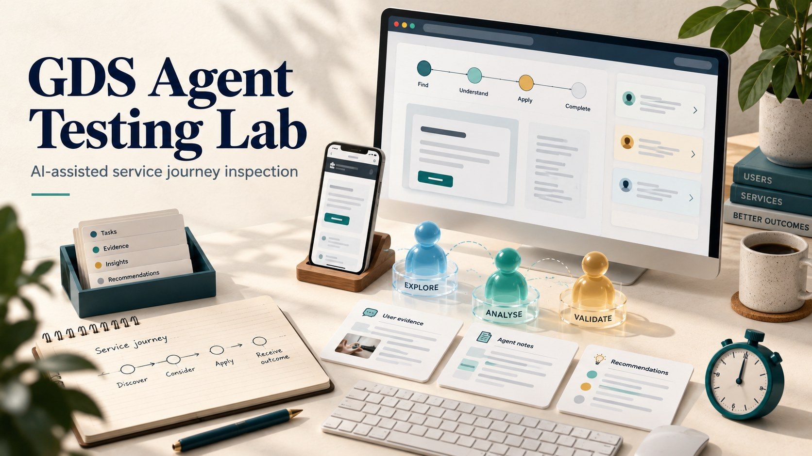
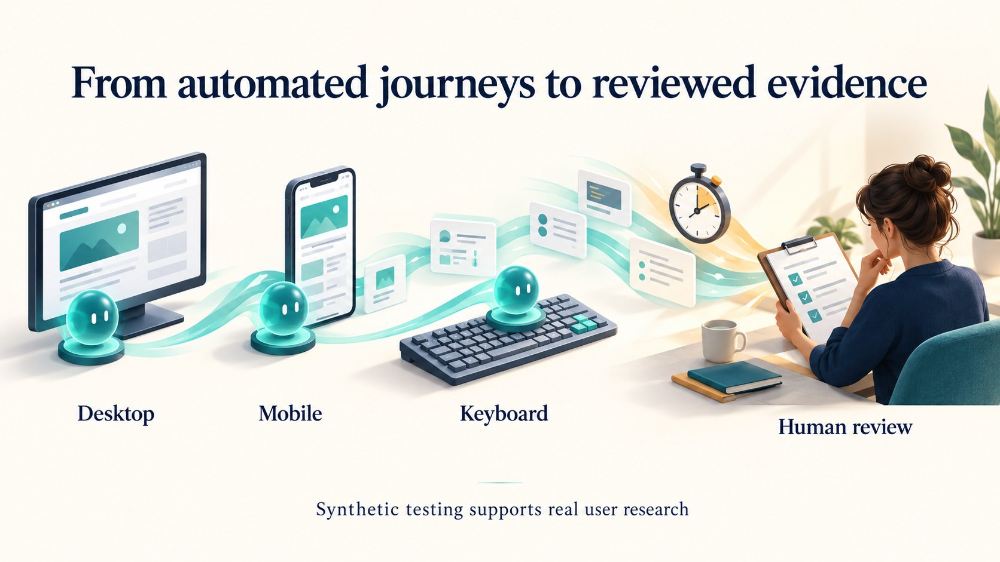

# GDS Agent Testing Lab

AI-assisted service journey inspection with Microsoft Foundry.



An open-source prototype for service designers and UX researchers to explore a test service through **desktop, mobile and keyboard agent profiles**, collect friction signals and review measured automated-run timings.

**This is synthetic journey testing. Agents are not research participants. This project does not perform an official GDS assessment, certify accessibility, or replace research with real users.** Independent project; not endorsed by Microsoft or the UK government.

## What it does

- Uses a Foundry-hosted model through the Responses API to select constrained browser actions.
- Runs three isolated Playwright browser contexts, sequentially.
- Captures screenshots, action rationale, observed alerts, potential label gaps and horizontal overflow.
- Records task outcome against an exact visible success marker.
- Exports a local HTML evidence report, JSON trace and timing CSV.
- Maps limited evidence to relevant GDS Service Standard points, leaving broader requirements unassessed.
- Includes a fictional fixture and deterministic demo that require no API key.



The artwork illustrates the concept; the report contains the actual collected evidence.

## Quick start

Requires Python 3.11+ and a machine supported by Playwright Chromium.

```bash
python -m venv .venv
source .venv/bin/activate
# Windows PowerShell: .venv\Scripts\Activate.ps1
pip install -r requirements.txt
python -m playwright install chromium
python run.py --demo
```

Open the printed `reports/<run>/report.html` path. Keep the entire run folder together so screenshot links work. The demo serves only the bundled fictional page on loopback and uses a scripted decision function, **not AI**. Expected fixture behavior: desktop and keyboard reach the marker; mobile encounters an intentionally blocked journey. The fixture also deliberately includes a label gap and narrow-screen overflow.

## Run with Microsoft Foundry

Deploy a model that supports the Responses API and JSON-object output. Set these environment variables in your shell; `.env.example` is documentation and is not loaded automatically.

```bash
export FOUNDRY_ENDPOINT="https://YOUR-RESOURCE.openai.azure.com/openai/v1"
export FOUNDRY_DEPLOYMENT="YOUR-DEPLOYMENT-NAME"
# Set FOUNDRY_API_KEY securely in your local environment.
```

The adapter also accepts `https://YOUR-RESOURCE.services.ai.azure.com/openai/v1`. This prototype uses an API key, not Azure managed identity or the managed Agent Service. Its agent loop runs locally and calls a Foundry-hosted model. Model access, deployment availability and usage charges belong to your Azure account.

Edit `example.json` with an **authorised, disposable staging service**, a task, synthetic data and a success marker that appears only after completion:

```bash
python run.py --config example.json --i-own-test-environment
```

To run the fixture with a real model, first start `python -m http.server 8090 --bind 127.0.0.1 --directory demo` in another terminal, then use the command above. Never paste credentials into chat or commit them.

## Reading the evidence

| Output | Interpretation |
|---|---|
| Success marker observed | Configured text became visible after an action; does not verify a back-end transaction |
| Step/time limit or agent stop | Task completion was not observed; investigate model, configuration and service |
| Harness error | Automation interruption; not automatically a service defect |
| Potential label/layout issue | Lightweight DOM signal requiring human verification |
| Visible alert | Page message preserved for review; may be expected validation |
| Human decision / severity | Pending / not assessed until a reviewer evaluates evidence |

| Timing | What is measured |
|---|---|
| Wall seconds | Entire journey, including model calls and evidence capture |
| Decision seconds | Time waiting for model decisions, or scripted decisions in demo mode |
| Browser seconds | Initial navigation plus executed browser actions and settling waits |
| Other seconds | Observation, screenshots and remaining runner overhead |

These are **automated operational timings, not estimates of human completion time**, service speed benchmarks or population statistics. Run budgets are soft: in-flight browser operations and final screenshots can exceed the configured deadline. Tokens returned by the provider are retained in JSON; no price estimate is fabricated.

## GDS scope

The report lists all 14 [GDS Service Standard points](https://www.gov.uk/service-manual/service-standard), using short project paraphrases. Browser traces may contribute limited evidence concerning task simplicity (4), inclusive access (5), and instrumentation discussions (10). They do not establish compliance with any point. Team structure, real user needs, cross-channel operation, privacy governance, reliability and delivery practices require other evidence and professional assessment.

Keyboard interaction is not a simulation of disability. A narrow viewport is not a validated mobile device or a representation of a demographic. The three profiles are experimental conditions, not representative users or independent research participants.

## Execution boundaries

Use synthetic content in an environment you control. Agents can submit same-origin forms and change server state. There is no transaction rollback or semantic protection against destructive buttons. The command-line acknowledgement is not a sandbox.

The harness blocks cross-origin requests, WebSockets, service workers, downloads and popups. This can break legitimate services using external assets or identity providers; blocked requests are retained in JSON. Use a dedicated test environment, never an authenticated production session. Same-origin code still executes. Do not expose hostile websites, secrets or sensitive records to this prototype.

Visible page text, field values, configured synthetic data and recent actions are sent to your Foundry deployment. Screenshots and reports stay in the local run folder; `store:false` does not override your Azure data policies. Review artefacts before sharing. Reports are excluded from git.

Supported controls are ordinary light-DOM links, buttons, inputs, textareas and selects. Iframes, complex custom widgets, screen readers, computed accessibility auditing, multi-origin journeys and real-device emulation are out of scope. No retry or recovery loop is currently implemented.

## Development

```bash
python -m unittest discover -s tests -v
```

See [methodology](docs/METHODOLOGY.md) and [verification](docs/VERIFICATION.md). Contributions should keep observed facts separate from inferred usability claims. Extend `runner.PROFILES` to add explicit interaction conditions; do not claim demographic validity without research.

## References and licence

- [Official GDS Service Standard](https://www.gov.uk/service-manual/service-standard)
- [Microsoft Foundry Responses API](https://learn.microsoft.com/en-us/azure/foundry/openai/how-to/responses)
- [Playwright browser contexts](https://playwright.dev/python/docs/api/class-browsercontext)

MIT licence — see [LICENSE](LICENSE). Created by Ramy Hammady.
